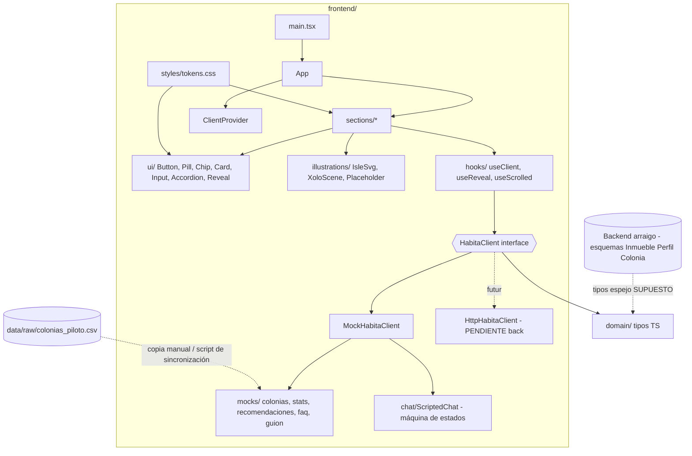
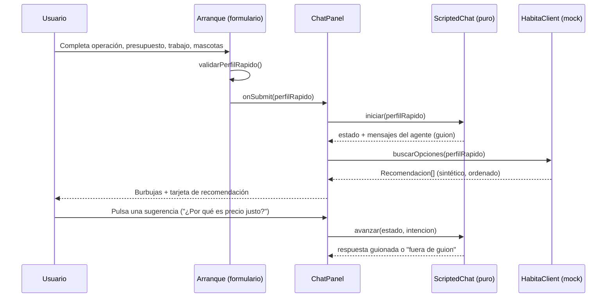
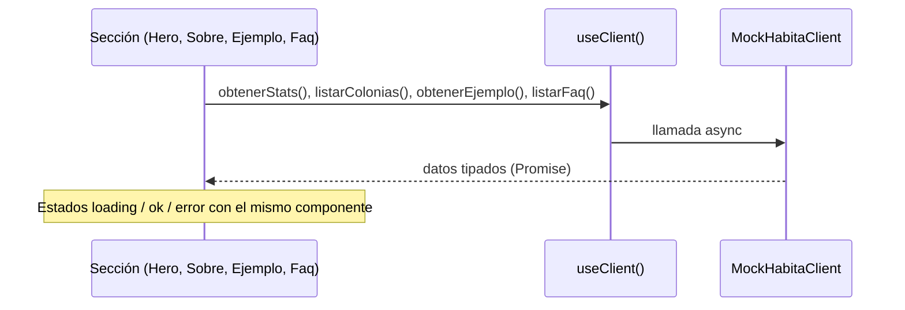

# Design Document: Frontend Landing Habita

## Overview

Este spec monta el proyecto web de **Habita** en `frontend/` (Vite + React + TypeScript, CSS con variables) y construye la landing completa descrita en `habita-diseno-web.md` como demo funcional sin backend. Todo dato viene de una interfaz `HabitaClient` con una implementación mock tipada. Cuando el equipo de backend defina su API, solo se agrega otra implementación de esa interfaz.

La demo incluye: navbar, hero con islas isométricas SVG, "Sobre Habita" con stats, 5 pilares, "Cómo funciona", ejemplo de recomendación, banda oscura, FAQ, arranque del chat (formulario rápido + chat simulado con respuestas guionadas) y footer. El código del front nunca llama a un LLM. El chat guionado es una máquina de estados determinista.

Alcance fuera de este spec: contrato de API real, agente MCP (spec 05), datos reales de colonias, nombre definitivo del producto.

### Estado del repo revisado (base para alinear tipos)

| Hallazgo | Detalle | Consecuencia |
|---|---|---|
| Esquemas Python | `src/arraigo/schemas/__init__.py` está vacío (1 línea). `inmueble.py`, `perfil.py`, `colonia.py` aún no existen (carriles A y B pendientes). | Los tipos TS se derivan de `.kiro/specs/01-modelo-datos/design.md`, no de código. Son **supuesto** hasta que existan los esquemas. |
| Specs | Solo existe `01-modelo-datos`. No existen specs 02-05 (carriles D y E pendientes). | Nada que alinear con antifraude, enriquecimiento ni MCP. El contrato de chat/recomendaciones es **pendiente del back**. |
| Colonias piloto | `data/raw/colonias_piloto.csv` tiene **13** filas. `product.md` dice 13. `habita-diseno-web.md` dice **15** (hero y stats). `requirements.md` de la spec 01 permite 10-15. | Discrepancia. Decisión de este spec: el mock deriva el conteo de la lista de colonias (13) y el copy no hardcodea 15. Ver "Decisiones abiertas". |
| Anuncios | Diseño visual dice "500 anuncios revisados". Spec 01 apunta a ~300 (rango 200-500), de los cuales solo 40-65 son reales. | La cifra de la landing es **pendiente del back**. El mock usa una constante marcada como provisional. |
| Zonas del hero | Las islas son Centro, Roma–Condesa y Coyoacán. En el CSV no hay colonias de Centro ni de Coyoacán; Roma Norte y Hipódromo (Condesa) sí. | Las islas son ilustrativas, no colonias piloto. El pill "15 colonias piloto" no debe implicar que cada isla es una colonia piloto. |
| Anuncios sintéticos | `product.md`: los sintéticos se marcan `fuente = "sintetico"` y el agente lo dice. | El mock lleva `fuente: "sintetico"` y la UI muestra "Datos de ejemplo" mientras use el cliente mock. |
| Assets | `caja.png` (700×700) y `pose.png` (700×700) están en la raíz del repo; `hero-clay.png` (1200×720) también, sin uso definido en el diseño. | Se copian (no se mueven) a `frontend/src/assets/xolo/`. `hero-clay.png` no se usa. |

## Architecture



Decisiones de arquitectura:

| Tema | Decisión | Alternativa descartada | Motivo |
|---|---|---|---|
| Build | Vite + React 18 + TypeScript estricto | Next.js | Landing de una página sin SSR; mínimo de configuración. El usuario eligió Vite. |
| Estilos | CSS plano con variables (`tokens.css`) + CSS Modules por componente | Tailwind, CSS-in-JS | Los tokens del documento se traducen 1:1 a variables. Sin dependencia extra. |
| Fuentes | `@fontsource-variable/bricolage-grotesque` e `@fontsource-variable/inter`, autoalojadas | Google Fonts por CDN | Sin petición externa en la demo ni problema de privacidad. |
| Routing | Una sola página con anclas (`#como-funciona`, `#colonias`, `#preguntas`, `#chat`) | React Router | No hay más vistas en el alcance. |
| Estado | `useState` y un contexto para el cliente | Redux, Zustand | Estado local y pequeño. |
| Datos | Interfaz `HabitaClient` inyectada por contexto | Importar fixtures directo en componentes | Cambiar a la API real toca un solo archivo. |
| Islas | SVG generado por componente a partir de una descripción de bloques (isométrico 30°) | PNG exportado | No existen los PNG. El SVG se parametriza y se ve nítido en cualquier tamaño. |
| Pruebas | Vitest + Testing Library + fast-check | Jest | Mismo toolchain que Vite. |
| Gestor de paquetes | npm (Node 25 y npm 11 presentes en la máquina) | pnpm, yarn | No hay otro instalado que se haya verificado. |

### Estructura de carpetas

```
frontend/
├── index.html
├── package.json            # scripts: dev, build, preview, test, lint, typecheck
├── tsconfig.json           # strict: true
├── vite.config.ts
└── src/
    ├── main.tsx
    ├── App.tsx
    ├── styles/             # tokens.css, base.css, motion.css
    ├── domain/             # tipos espejo del back (SUPUESTO) + tipos de UI
    ├── client/             # HabitaClient.ts, MockHabitaClient.ts, ClientProvider.tsx
    ├── mocks/              # colonias.ts, stats.ts, recomendaciones.ts, faq.ts, guion.ts
    ├── chat/               # scriptedChat.ts (máquina de estados pura), ChatPanel.tsx
    ├── sections/           # Navbar, Hero, Sobre, Pilares, Como, Ejemplo, Banda, Faq, Arranque, Footer
    ├── ui/                 # Button, Pill, Chip, Card, Input, Toggle, Accordion, Reveal, Stat
    ├── illustrations/      # IsleScene, iso.ts, XoloScene, Greca, Placeholder
    ├── hooks/              # useReveal, useScrolled, useReducedMotion, useMediaQuery
    ├── lib/                # color.ts (shade), format.ts (MXN), iso.ts (proyección)
    └── assets/xolo/        # caja.png, pose.png (+ placeholders generados)
```

## Sequence Diagrams





## Components and Interfaces

### Capa de acceso a datos (aislada)

**Propósito**: única frontera con el back. Los componentes solo conocen esta interfaz.

```ts
// client/HabitaClient.ts
export interface HabitaClient {
  readonly origen: "mock" | "api";           // la UI muestra "Datos de ejemplo" si es "mock"
  listarColonias(): Promise<ColoniaResumen[]>;
  obtenerStats(): Promise<StatsLanding>;
  obtenerEjemplo(): Promise<RecomendacionEjemplo>;   // el de la sección 3.6
  listarFaq(): Promise<PreguntaFrecuente[]>;
  buscarOpciones(perfil: PerfilRapido): Promise<ResultadoBusqueda>;
  // Chat: ver sección "Chat guionado". PENDIENTE back: no se define aquí un método responderChat() de la API real.
}
```

**Responsabilidades**:
- `MockHabitaClient` implementa la interfaz con fixtures y una latencia simulada configurable (por defecto 400 ms, 0 en pruebas).
- `ClientProvider` expone el cliente por contexto. Se elige por `import.meta.env.VITE_HABITA_CLIENT` (`mock` por defecto). `api` queda sin implementar y lanza error claro si se activa.
- Ningún componente importa de `mocks/` directamente.

### Componentes de sección

| Sección | Componente | Datos | Notas |
|---|---|---|---|
| 3.1 | `Navbar` | — | Transparente sobre el hero; `paper` con borde inferior cuando `scrollY > 8`. Hamburguesa <768 con `aria-expanded`. Botón "Hablar con Habita" va a `#chat`. En móvil, pill flotante fija abajo. |
| 3.2 | `Hero` + `IsleScene` | `listarColonias()` para el pill | Contenedor `radius-lg`, ~640 px, fondo `cielo`. Etiquetas pill HTML sobre cada isla. Card flotante con Xolo miniatura. |
| 3.3 | `Sobre` + `StatsRow` | `obtenerStats()` | Imagen `pose.png` sobre fondo `sol`. |
| 3.4 | `Pilares` | constante local de copy | 5 cards, 3+2 en escritorio. Cada card con greca tezontle distinta (SVG, variantes A-E). Link "Ver ejemplo →" lleva a `#ejemplo`. |
| 3.5 | `ComoFunciona` | constante local | Paso 1 y 2 con `Placeholder`; paso 3 con `caja.png`. |
| 3.6 | `EjemploRecomendacion` | `obtenerEjemplo()` | Chat mock estático + card de recomendación con ilustración de depa (SVG). |
| 3.7 | `BandaOscura` | — | Fondo `ink`, grecas `tezontle-bright` o islas de noche en SVG. Botón va a `#chat`. |
| 3.8 | `Faq` + `Accordion` | `listarFaq()` | Un item abierto a la vez. Botón-card "Pregúntale a Habita" va a `#chat`. |
| 3.9 | `Arranque` + `ChatPanel` | `buscarOpciones()` | Formulario rápido; al enviar, el bloque pasa a modo chat. |
| 3.10 | `Footer` | — | Fuentes y aviso legal en texto estático. |

### Componentes UI base

```ts
type ButtonProps = { variante: "primario" | "secundario"; sobre?: "claro" | "ink"; flecha?: boolean; href?: string } & ButtonHTMLAttributes;
type PillProps   = { punto?: boolean; children: string };            // pill de sección
type ChipProps   = { variante: "neutro" | "confianza" | "alerta" | "ia"; children: ReactNode };
type RevealProps = { retrasoMs?: number; children: ReactNode };      // fade + 16 px, 400 ms
type StatProps   = { valor: number | string; etiqueta: string; sufijo?: string };
```

Reglas aplicadas (del documento): un solo botón primario tezontle por vista visible; la palabra resaltada aparece una vez por página (hero). En la banda oscura la palabra "lugar" usa `tezontle-bright` sin bloque, para no contar como segunda palabra resaltada.

### Ilustración

```ts
// illustrations/IsleScene.tsx
type Bloque = { x: number; y: number; ancho: number; fondo: number; alto: number; color: string; techo?: "plano" | "casita" };
type Isla    = { id: "centro" | "roma-condesa" | "coyoacan"; origen: [number, number]; bloques: Bloque[]; arboles: Arbol[] };
function IsleScene(props: { islas: Isla[]; animar: boolean }): JSX.Element;

// lib/iso.ts
function proyectar(x: number, y: number, z: number): [number, number];   // isométrico 30°
function cara(color: string, tipo: "arriba" | "izq" | "der"): string;    // color de relleno
```

- Proyección: `sx = (x - y) * cos(30°)`, `sy = (x + y) * sin(30°) - z`.
- Caras sin contorno. Interpretación de "100/80/125%": cara superior 100% del color base, izquierda 80% (más oscura), derecha 125% (más clara). `cara()` calcula el factor en espacio HSL y limita la luminosidad a 96% para no quemar el color. **Supuesto a confirmar con diseño.**
- Edificios tezontle, edificios claros (`paper`), casitas de colores (`sol`, `durazno`, `jacaranda`), árboles verdes y morados. El verde de los árboles no está en la paleta: se propone `#5E9E6B` (ver tokens propuestos).
- Xolo facetado sobre las islas: no existe como asset vectorial. Se dibuja como `XoloFaceted` SVG simple (polígonos con planos `#4D535C` y `#2C3036`, greca tezontle, destello de 4 puntas). **Es aproximación del estilo; la versión final la entrega el ilustrador.**
- Escenas del Xolo: `XoloScene` recibe `escena: "mapa" | "revisando" | "caja" | "llaves" | "dormido" | "sentado" | "recostado"`. Con PNG disponible lo usa. Si no, renderiza `Placeholder` con el mismo fondo sólido y la etiqueta de la escena para que se note que falta.

| Escena | Archivo | Fondo | Estado |
|---|---|---|---|
| caja (Cómo funciona, paso 3) | `assets/xolo/caja.png` | `durazno` | Existe en la raíz del repo |
| recostado (Sobre Habita) | `assets/xolo/pose.png` | `sol` | Existe en la raíz del repo |
| mapa (paso 1) | `assets/xolo/mapa.png` | `durazno` | Placeholder |
| revisando anuncios (paso 2) | `assets/xolo/revisando.png` | `tezontle-soft` | Placeholder |
| sentado (chat) | `assets/xolo/sentado.png` | `paper`/`sol` por definir | Placeholder |
| llaves, dormido | `assets/xolo/llaves.png`, `dormido.png` | por definir | Placeholder, sin sección que los use aún |

Nota: el documento llama `sol` al fondo de "Sobre Habita" y `durazno` al de la caja; hay que comprobar que los PNG recibidos coinciden con esos colores sólidos, porque los PNG traen el fondo horneado.

## Data Models

### Tipos espejo del back (SUPUESTO, derivados de `01-modelo-datos/design.md`)

Se usan nombres de campo idénticos (español sin acentos, snake_case) para que el cambio a la API no obligue a renombrar. Si el back cambia los esquemas, solo se edita `domain/backend.ts`.

```ts
// domain/backend.ts
export type Operacion = "renta" | "venta";
export type Requisito = "aval" | "poliza" | "deposito_extra" | "ninguno";

export interface Inmueble {
  id: string;
  operacion: Operacion;
  precio_mxn: number;                 // entero > 0, MXN sin centavos
  colonia: string;
  alcaldia: string;
  lat: number | null;
  lng: number | null;
  ubicacion_aproximada: boolean;
  m2: number | null;
  recamaras: number;
  banos: number;
  estacionamiento: number;
  acepta_mascotas: boolean | null;
  amueblado: boolean | null;
  requisitos: Requisito[];
  descripcion: string;
  fuente: string;                     // "sintetico" | "captura_manual:<portal>"
  fecha_captura: string;              // ISO date
  url_origen: string | null;
  es_fraude_prueba: boolean;          // NO se muestra ni se usa en la UI
}

export interface Dato<T> { valor: T | null; fuente: string | null; fecha_dato: string | null }

export interface Perfil {            // referencia; la landing solo captura un subconjunto (PerfilRapido)
  operacion_deseada: "renta" | "compra" | "ambas";
  presupuesto_max_mxn: number;
  destino_trabajo: { lat: number; lng: number; direccion: string };
  mascotas: boolean;
  /* resto de campos de spec 01: fuera del formulario rápido */
}

export interface Colonia {
  nombre: string;
  alcaldia: string;
  centroide: Dato<{ lat: number; lng: number }>;
  precio_m2_renta_mediana: Dato<number>;
  precio_m2_venta_mediana: Dato<number>;
  indice_delitos: Dato<number>;                 // spec 02, null por ahora
  indicador_presion_gentrificacion: Dato<number>; // spec 02, null por ahora
  /* estaciones, riesgo, puntos_comunidad: spec 02 */
}
```

Los esquemas Python que se vayan a escribir pueden cambiar `Perfil` (por ejemplo `operacion_deseada` admite "ambas"). El formulario del front solo ofrece renta o compra.

### Tipos propios del front (no vienen del back)

```ts
// domain/ui.ts
export interface ColoniaResumen {            // fila de colonias_piloto.csv
  colonia: string;
  alcaldia: string;
  hipotesis_presion: "alta" | "media" | "baja";   // hipótesis del equipo, NO indicador real
  rol: "zona_presionada" | "en_transicion" | "alternativa";
}

export interface StatsLanding {
  colonias: number;                // mock: colonias.length (13)
  anuncios: number;                // mock: constante PROVISIONAL
  porcentajeExplicado: number;     // 100 por diseño; texto de marketing
  origen: "mock" | "api";
}

export interface PerfilRapido {
  operacion: "renta" | "compra";
  presupuesto_max_mxn: number;     // 1_000 – 50_000_000 (rango de spec 01)
  destino_trabajo: string;         // texto libre; sin geocodificar en el front
  mascotas: boolean;
}

export interface RecomendacionEjemplo {
  titulo: string;                  // p. ej. "Depa de 2 recámaras en <colonia>"
  colonia: string;
  operacion: Operacion;
  precio_mxn: number;
  chips: { texto: string; variante: "confianza" | "neutro" | "alerta" | "ia" }[];
  datoComunidad: { texto: string; fuente: string; fecha_dato: string };
  esEjemplo: true;                 // siempre true en mock; se muestra "Datos de ejemplo"
}

export interface ResultadoBusqueda { opciones: RecomendacionEjemplo[]; mensajeSinResultados?: string }
export interface PreguntaFrecuente { id: string; pregunta: string; respuesta: string }
```

**Reglas de validación**
- `PerfilRapido.presupuesto_max_mxn`: entero, 1 000 a 50 000 000. Tope de spec 01. Un presupuesto de renta realista (< 1 000) se rechaza con mensaje inline.
- `destino_trabajo`: 2 a 120 caracteres tras `trim()`.
- `ColoniaResumen`: los valores de `hipotesis_presion` y `rol` se validan al cargar el fixture. Un valor desconocido falla en la prueba, no en producción.
- La UI nunca muestra `hipotesis_presion` como dato oficial. Si se muestra, rotula "hipótesis del equipo".

### Mock de colonias

`mocks/colonias.ts` replica las 13 filas de `data/raw/colonias_piloto.csv`. Se mantiene sincronizado con un script (`frontend/scripts/sync-colonias.mjs`) que lee el CSV y regenera el archivo; una prueba verifica que el fixture y el CSV coinciden. Así el conteo del pill y de la stat no queda desactualizado.

## Tokens de diseño

Los tokens del documento van a `styles/tokens.css` sin cambios. Valores propuestos para lo que falta:

| Token | Valor propuesto | Uso | Verificación |
|---|---|---|---|
| `--stone` (definición pendiente) | `#B9B6AE` | Enlaces del footer sobre `ink` | Contraste con `ink` ≈ 8.8:1 (calcular con herramienta antes de cerrar) |
| `--jacaranda-soft` (definición pendiente) | `#E6DDF7` | Fondo de badge "IA" y avatar del agente | Texto `ink` sobre este fondo > 12:1 |
| `--jacaranda-ink` (propuesto, nuevo) | `#4B2F8A` | Texto del badge "IA" | ≈ 8:1 sobre `jacaranda-soft` (verificar) |
| `--ok-soft` / `--ok-ink` (propuesto, nuevo) | `#DCEBDD` / `#2F5D3A` | Chip "confianza" ("verde suave" sin valor en el doc) | ≈ 6:1 (verificar) |
| `--arbol-verde` / `--arbol-morado` (propuesto, nuevo) | `#5E9E6B` / `#7A5FB8` | Árboles en islas SVG | Solo decorativo |
| `--cielo-noche` (propuesto, nuevo) | `#1E2A44` | Islas de noche en banda oscura, si se elige esa opción | Solo decorativo |

Cuatro de estos tokens no están en el documento. Se proponen para poder construir; hay que confirmarlos con diseño.

Escala de espaciado `--sp-1..8` = 4, 8, 12, 16, 24, 32, 48, 96 px. Radios `--r-sm` 8, `--r-md` 16, `--r-lg` 28, `--r-pill` 999. Tipografía como clases utilitarias (`.t-hero`, `.t-h1`, …) con `clamp()` solo donde el documento define dos tamaños (hero 72→44, secciones 96→64).

## Algorithmic Pseudocode

### Chat guionado (máquina de estados pura)

El chat no interpreta lenguaje libre. El usuario avanza con sugerencias (botones) o con el formulario. Un texto escrito a mano se responde con un mensaje fijo que redirige a las sugerencias.

```ts
type EstadoChat =
  | { fase: "inicio" }
  | { fase: "resultados"; perfil: PerfilRapido; opciones: RecomendacionEjemplo[]; indice: number }
  | { fase: "explicando"; perfil: PerfilRapido; opciones: RecomendacionEjemplo[]; indice: number; tema: Tema };

type Tema = "precio_justo" | "confianza" | "comunidad" | "gentrificacion" | "costo_real";
type Intencion = { tipo: "tema"; tema: Tema } | { tipo: "otra_opcion" } | { tipo: "texto_libre"; texto: string } | { tipo: "reiniciar" };

interface Mensaje { id: string; autor: "usuario" | "agente"; texto: string; tarjeta?: RecomendacionEjemplo; sugerencias?: Intencion[] }

function iniciar(perfil: PerfilRapido, resultado: ResultadoBusqueda): { estado: EstadoChat; mensajes: Mensaje[] }
function avanzar(estado: EstadoChat, intencion: Intencion): { estado: EstadoChat; mensajes: Mensaje[] }
```

```ts
function avanzar(estado, intencion) {
  // Precondición: estado es válido; intencion pertenece a las sugerencias vigentes o es texto_libre
  if (intencion.tipo === "reiniciar") return { estado: { fase: "inicio" }, mensajes: [saludo()] };
  if (estado.fase === "inicio") return { estado, mensajes: [pidePerfil()] };      // no hay perfil todavía

  switch (intencion.tipo) {
    case "tema":
      return { estado: { ...estado, fase: "explicando", tema: intencion.tema },
               mensajes: [usuario(etiqueta(intencion.tema)), agente(GUION[intencion.tema], estado.opciones[estado.indice])] };
    case "otra_opcion": {
      const i = (estado.indice + 1) % estado.opciones.length;        // rota, nunca falla
      return { estado: { ...estado, fase: "resultados", indice: i }, mensajes: [agente(intro(i), estado.opciones[i])] };
    }
    case "texto_libre":
      return { estado, mensajes: [usuario(intencion.texto), agente(FUERA_DE_GUION)] };   // estado no cambia
  }
}
```

**Precondiciones**
- `opciones` no está vacío en las fases `resultados` y `explicando`. Si la búsqueda no devuelve nada, `iniciar` produce un mensaje de "sin resultados" y deja el estado en `inicio`.
- `indice` está en `[0, opciones.length)`.

**Postcondiciones**
- Función pura: misma entrada, misma salida. Sin `Date.now()`, sin `Math.random()`. Los ids de mensaje se derivan de un contador dentro del estado.
- Todo mensaje del agente que cita un dato incluye `fuente` visible (de la tarjeta) y el texto "Datos de ejemplo" mientras `origen === "mock"`.
- `texto_libre` nunca cambia `fase` ni `indice`.

**Invariante de bucle**: N/A (no hay bucles; `otra_opcion` es aritmética modular).

### Filtro del mock `buscarOpciones`

```ts
function buscarOpciones(perfil: PerfilRapido, catalogo: RecomendacionEjemplo[]): ResultadoBusqueda {
  const candidatas = [];
  for (const r of catalogo) {
    // Invariante: candidatas contiene solo elementos ya revisados con operacion igual y precio <= presupuesto
    if (r.operacion === (perfil.operacion === "compra" ? "venta" : "renta") && r.precio_mxn <= perfil.presupuesto_max_mxn) {
      candidatas.push(r);
    }
  }
  candidatas.sort((a, b) => b.precio_mxn - a.precio_mxn || a.titulo.localeCompare(b.titulo, "es"));
  return candidatas.length > 0
    ? { opciones: candidatas.slice(0, 3) }
    : { opciones: [], mensajeSinResultados: "Con ese presupuesto no tenemos ejemplos. Prueba subirlo un poco." };
}
```

**Precondiciones**: `perfil` ya validado; `catalogo` con `esEjemplo === true`.
**Postcondiciones**: devuelve 0 a 3 opciones; todas cumplen operación y presupuesto; orden estable y determinista; el mock no usa `mascotas` ni `destino_trabajo` para filtrar (no hay datos reales con que hacerlo) y la respuesta guionada lo dice abiertamente.

### Validación del formulario

```ts
function validarPerfilRapido(entrada: { operacion: string; presupuesto: string; destino: string; mascotas: boolean | null }):
  { ok: true; perfil: PerfilRapido } | { ok: false; errores: Partial<Record<"presupuesto" | "destino" | "mascotas", string>> }
```

Precondición: ninguna (acepta texto crudo). Postcondición: `ok === true` si y solo si presupuesto es entero en `[1000, 50_000_000]`, destino tiene 2–120 caracteres tras `trim`, y mascotas es booleano. Acepta "12,500" y "$12 500" como 12500.

### Proyección isométrica y sombreado

```ts
function proyectar(x, y, z) { const c = Math.cos(Math.PI / 6), s = Math.sin(Math.PI / 6); return [(x - y) * c, (x + y) * s - z]; }
function cara(hex, tipo) { const f = { arriba: 1.0, izq: 0.8, der: 1.25 }[tipo]; return hslConLuminosidadEscalada(hex, f, /*tope*/ 0.96); }
```

Postcondiciones: `proyectar(0,0,0) = [0,0]`; subir `z` en `d` mueve el punto exactamente `d` hacia arriba; `cara(hex, "arriba") = hex` salvo redondeo; el resultado siempre es un hex válido.

## Key Functions with Formal Specifications

| Función | Precondición | Postcondición |
|---|---|---|
| `formatMXN(n: number): string` | `n` entero finito | Devuelve `"$12,500"` (es-MX, sin decimales). No lanza. |
| `useReveal(ref)` | Nodo montado | Con `prefers-reduced-motion`, el elemento es visible desde el primer render y no hay transición. |
| `sincronizarColonias(csv: string)` | CSV UTF-8 con encabezado `colonia,alcaldia,hipotesis_presion,rol` | Un `ColoniaResumen` por fila; falla si hay valor fuera de los enums. |
| `ScriptedChat.avanzar` | Ver arriba | Ver arriba |
| `Accordion` | Lista con ids únicos | A lo mucho un item abierto; `aria-expanded` coincide con el estado visual; Enter/Espacio alterna. |

## Example Usage

```tsx
// App.tsx
<ClientProvider client={new MockHabitaClient({ latenciaMs: 400 })}>
  <Navbar /><main><Hero /><Sobre /><Pilares /><ComoFunciona /><EjemploRecomendacion /><BandaOscura /><Faq /><Arranque /></main><Footer />
</ClientProvider>

// sections/Sobre.tsx
const { client } = useClient();
const stats = useAsync(() => client.obtenerStats(), [client]);   // { cargando | ok | error }
<Stat valor={stats.data.colonias} etiqueta="colonias" />

// Cambiar a la API real (futuro, cuando el back publique contrato)
// client/HttpHabitaClient.ts implements HabitaClient  ->  VITE_HABITA_CLIENT=api
```

## Responsive, movimiento y accesibilidad

- Breakpoints: `≥1200` layout completo; `768–1199` grids de 3 pasan a 2 y el hero apila texto arriba e islas abajo; `<768` una columna, hero 44/48, secciones 64 px, hamburguesa y botón "Hablar" fijo abajo.
- Entrada de secciones: fade + 16 px, 400 ms ease-out, escalonado 60 ms. Islas con bobbing ±6 px en 6 s, desfasadas. Destellos 0.4→1 en 2.4 s. Con `prefers-reduced-motion: reduce` todo se desactiva (CSS y `useReveal`).
- Foco visible: anillo 2 px `tezontle` con separación 2 px en todos los interactivos.
- Imágenes decorativas `alt=""`; escenas de Cómo funciona con `alt` descriptivo ("El Xolo con un mapa, eligiendo una colonia"). Los placeholders llevan `role="img"` con el mismo `alt` para no perder la descripción.
- El chat es una región `aria-live="polite"`. Las sugerencias son `button`. El FAQ y el menú móvil son operables por teclado.
- Los contrastes del documento se verifican con una prueba que calcula la razón para cada par declarado y los pares propuestos.

## Correctness Properties

*Property 1: Búsqueda mock coherente*

Para todo `PerfilRapido` válido y todo catálogo, `buscarOpciones` devuelve opciones con la operación pedida y `precio_mxn <= presupuesto_max_mxn`, como máximo 3, y el mismo resultado en dos llamadas.

*Property 2: Chat guionado total*

Para toda secuencia de intenciones, `avanzar` nunca lanza, `indice` permanece en rango y `texto_libre` no cambia `fase` ni `indice`.

*Property 3: Formato MXN reversible*

Para todo entero `n`, `formatMXN(n)` se lee de vuelta (quitando `$` y `,`) como `n`.

*Property 4: Geometría y color válidos*

Para todo `hex` válido y tipo de cara, `cara(hex, tipo)` es un hex válido; `proyectar` cumple las igualdades de arriba.

*Property 5: Validación del formulario*

Para toda cadena de entrada del formulario, `validarPerfilRapido` devuelve `ok: true` si y solo si cumple las reglas de rango; los errores indican el campo.

*Property 6: Fixture de colonias sincronizado*

`colonias.ts` coincide fila por fila con `data/raw/colonias_piloto.csv`, y `stats.colonias === colonias.length` en el mock.

*Property 7: Marca de datos de ejemplo*

Mientras `client.origen === "mock"`, toda vista que muestra precios, stats o recomendaciones muestra la marca "Datos de ejemplo".

*Property 8: Sin LLM ni claves en el front*

Ningún archivo bajo `frontend/src` contiene llamadas a un servicio de LLM ni claves de API. Se verifica con búsqueda en una prueba.

*Property 9: Movimiento reducido*

Con `prefers-reduced-motion`, ninguna animación CSS con `animation-duration > 0` queda activa en los elementos animados.

*Property 10: Énfasis de marca único*

Hay una sola instancia de la "palabra resaltada" y un solo botón primario tezontle por sección visible.


## Error Handling

### Fallo del cliente de datos
**Condición**: una promesa del cliente rechaza (en mock solo ocurre con `VITE_MOCK_FAIL=1`, para probar).
**Respuesta**: la sección muestra un estado de error discreto ("No pudimos cargar esto. Reintentar") sin romper el resto de la página.
**Recuperación**: botón "Reintentar" repite la llamada.

### Formulario inválido
**Condición**: presupuesto fuera de rango o destino vacío.
**Respuesta**: error inline bajo el campo, `aria-invalid` y `aria-describedby`; el foco pasa al primer campo con error.
**Recuperación**: se corrige y se reenvía; no se pierde lo capturado.

### Búsqueda sin resultados
**Condición**: ninguna recomendación del catálogo cumple operación y presupuesto.
**Respuesta**: el agente dice que no hay ejemplos con ese presupuesto, sin inventar uno.
**Recuperación**: sugerencia "Cambiar mi búsqueda" que vuelve al formulario con los valores previos.

### Asset faltante
**Condición**: no está el PNG de una escena.
**Respuesta**: se renderiza el `Placeholder` con el fondo sólido de la escena y su nombre.
**Recuperación**: al copiar el archivo a `assets/xolo/` y registrarlo en el mapa de escenas, desaparece el placeholder.

### Cliente `api` sin implementar
**Condición**: `VITE_HABITA_CLIENT=api` antes de que exista `HttpHabitaClient`.
**Respuesta**: error al arrancar con mensaje claro. No hay fallback silencioso al mock.

## Testing Strategy

### Pruebas unitarias (Vitest + Testing Library)
- Render de cada sección con el cliente mock; `Accordion` (teclado, `aria-expanded`); `Navbar` (cambia al hacer scroll, menú móvil); `Button` (variantes); `Stat`.
- `validarPerfilRapido` con casos de borde: "0", "1000", "50000000", "50000001", "12,500", vacío, destino de 1 y 121 caracteres.
- `ScriptedChat`: flujo completo inicio → resultados → explicar → otra opción → reiniciar.
- Fixture vs CSV de colonias.

### Pruebas basadas en propiedades
**Librería**: fast-check. Cubre las propiedades 1 a 5 y 8.

### Contraste y accesibilidad
- Prueba de razón de contraste para los pares del documento y los tokens propuestos.
- `axe` (vitest-axe) sobre la página completa en estado mock; sin violaciones serias.

### Verificación manual (la demo es visual)
- Revisar 1440, 1024 y 390 px de ancho; con y sin `prefers-reduced-motion`; teclado completo; que los placeholders se distingan de las escenas finales.
- `npm run build` y `npm run typecheck` sin errores.

## Performance Considerations

- PNG de 700×700 con grano: se muestran a ≤ 420 px; usar `loading="lazy"` y `width/height` explícitos para evitar salto de layout. Convertir a WebP es opcional y no se hace sin avisar (el grano de papel puede degradarse).
- Islas SVG: geometría generada una vez (`useMemo`); la animación usa solo `transform` en el grupo de cada isla.
- Fuentes variables autoalojadas con `font-display: swap`.

## Security Considerations

- No hay claves ni tokens en el front. `INEGI_TOKEN` y `BANXICO_TOKEN` son del back y nunca se exponen aquí.
- El texto libre del chat se renderiza como texto (sin `dangerouslySetInnerHTML`) y no se envía a ningún lado.
- Cuando exista la API real: URL base por variable de entorno `VITE_API_URL`, CORS lo configura el back, y no se guardan datos personales en `localStorage` sin decisión explícita.
- El aviso "Habita recomienda; no es asesoría legal ni financiera" aparece en el footer y bajo el formulario.

## Dependencies

| Paquete | Uso |
|---|---|
| `react`, `react-dom` 18 | UI |
| `vite`, `@vitejs/plugin-react`, `typescript` | Build |
| `@fontsource-variable/bricolage-grotesque`, `@fontsource-variable/inter` | Tipografías |
| `vitest`, `@testing-library/react`, `@testing-library/user-event`, `jsdom`, `fast-check`, `vitest-axe` | Pruebas |
| `eslint`, `typescript-eslint` | Lint |

Sin librerías de componentes, animación ni íconos: los íconos son SVG propios. Las versiones exactas las fija `package.json` al instalar.

## Pendientes que dependen del backend

| # | Pendiente | Estado en este spec |
|---|---|---|
| P1 | Contrato de API del chat y de recomendaciones (la herramienta MCP de spec 05 no existe) | Solo la interfaz `HabitaClient` y un chat guionado. No se define un `responderChat` real. |
| P2 | Stats reales: número de colonias piloto (13 en CSV vs 15 en el diseño) y de anuncios (500 en el diseño vs ~300 objetivo de spec 01) | Mock con 13 y una constante provisional para anuncios. |
| P3 | Nombre definitivo del producto (Habita en UI, `arraigo` en el paquete) | Marca en un solo módulo `brand.ts` para cambiarla en un punto. |
| P4 | Esquemas Pydantic reales (`Inmueble`, `Perfil`, `Colonia`) | Tipos TS espejo de `design.md` de spec 01, marcados como supuesto. |
| P5 | Datos de comunidad, riesgo y presión de gentrificación (spec 02) | El dato de comunidad del ejemplo es ficticio y rotulado. |
| P6 | Forma de servir el front junto al back (proxy, CORS, hosting) | Fuera de alcance; `npm run dev` y `build` estáticos. |

## Decisiones abiertas para el usuario o diseño

1. **13 vs 15 colonias**: se propone mostrar 13 (el dato real del repo) y actualizar el documento de diseño. Si el equipo planea llegar a 15, basta agregar filas al CSV y regenerar el fixture.
2. **"500 anuncios revisados"**: es una cifra de marketing sin respaldo hoy. Se propone un valor provisional marcado, o cambiar la stat a "13 colonias · 3 anuncios por colonia mínimo" cuando se tenga el dato real.
3. **Islas del hero vs colonias piloto**: Centro y Coyoacán no están en el CSV. Se propone mantenerlas como zonas ilustrativas, o cambiar la isla a "Juárez" y "Del Valle" para coincidir con datos reales.
4. **Interpretación 100/80/125%** del sombreado isométrico y los tokens nuevos de la tabla de tokens.
5. **Fondos de los PNG**: confirmar que `pose.png` está sobre `sol` y `caja.png` sobre `durazno`, ya que el fondo viene incluido en la imagen.
